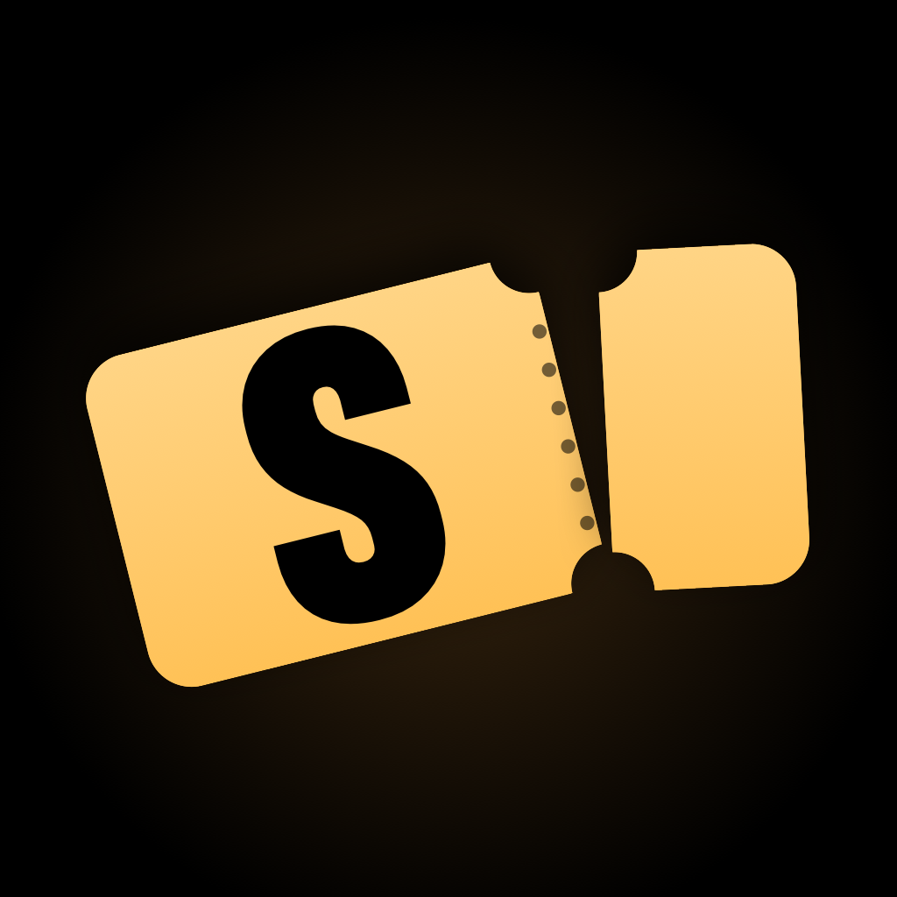

<h1 align="center">Scene Stash</h1>

A film and TV tracker for iOS that treats every night in like a night at the pictures.

&nbsp; A <a href="https://github.com/Patels-Labs"><b>Patel's Labs</b></a> project

Tonight's programme is laid out when you open the app: the next episode of everything you're watching, the film you're halfway through, and a pick from your watchlist. Add a title and it tears off a ticket into your stash, sorted into Watchlist, Watching and Seen. Movie nights, a year in review and widgets are in 2.0, currently on TestFlight.

Built with Swift and UIKit for iOS 26. Film and TV data comes from TMDB, and your stash syncs through iCloud.
